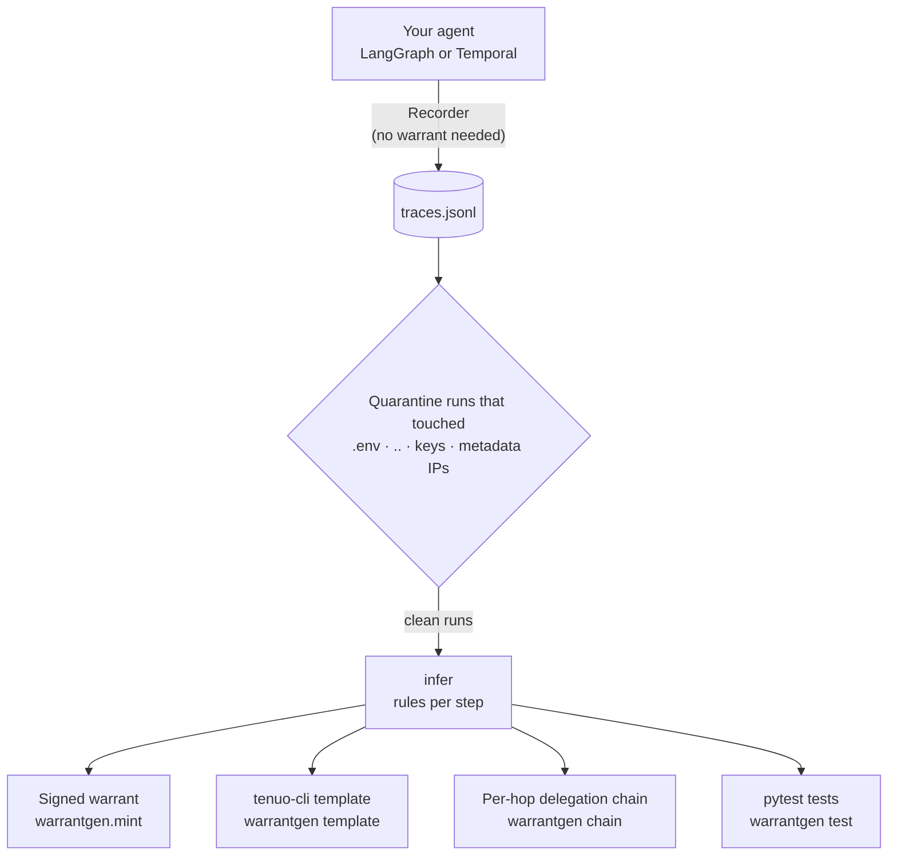
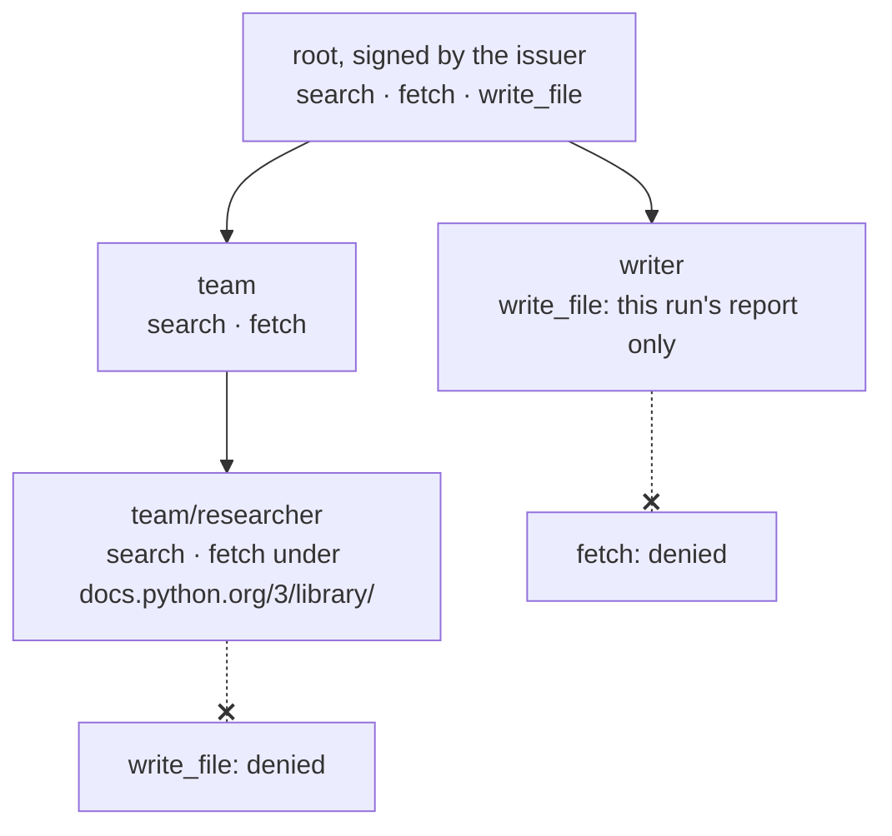

# warrantgen

[](https://github.com/RajanChavada/warrantgen/actions/workflows/tests.yml)

Record what your AI agent actually does, then get the narrowest [Tenuo](https://github.com/tenuo-ai/tenuo) warrant
that still allows it: signed, per step, per sub-agent, with tests that keep it honest in CI.

Writing least-privilege warrants by hand is the slow part of adopting Tenuo. A real Temporal agent needed ~290 lines
of hand-written warrant, key and audit code. warrantgen infers the same constraints from recorded runs, and on that
agent's held-out runs it allows every legitimate call and denies every injected secret read.

## How it works



1. **Record** tool calls with a LangChain callback or Tenuo's Temporal `audit_callback`. Each call is tagged with its
   run and its step (a LangGraph node path, or the warrant that checked it on Temporal).
2. **Quarantine** any run that touched a secret file, a `..` path or a private host. It is never learned from.
3. **Infer** one rule per argument from several runs: what's fixed, what changes per run, what's free text.
4. **Use** the rules: mint a warrant, write a `tenuo-cli` template, mint a delegation chain, or generate tests.

## What inference looks like

Rules inferred from 15 recorded runs of a real agent on 3 sites, next to the warrant its authors wrote by hand
(the `fetch.url` row comes from the LangGraph example):

| Argument | Recorded values | Inferred rule | Hand-written warrant |
|---|---|---|---|
| `repo` | one per run: `acme/site`, `northside/bakery-web`, ... | per-run value → `Exact` | `Exact(repo)` |
| `path` | this run's files | per-run list → `OneOf` | `OneOf(paths)` |
| `branch` | `fixagent/agent-20261018-014809`, ... | per-run value (or `Pattern("fixagent/*")`) | `Pattern("fixagent/*")` |
| `size` | 1 to 503 | `Range(0, 1000)` (rounded headroom) | `Range(max=20000)` |
| `text`, `message`, `body` | free text | `Wildcard` | `Wildcard` |
| `read_file.path` | files under `public/`, `web/` | under those folders, minus secrets and `..` | the same `All([...])` shape |
| `fetch.url` | pages on `docs.python.org/3/library/` | `UrlPattern(".../3/library/*")` | n/a |

Reads generalize to their folders or URL prefix (several hosts become `AnyOf` of one `UrlPattern` per host); writes keep
their exact files. Money-like arguments (`amount`, `price`, `cents`, ...) never get headroom.

## Per-hop delegation chains

When a LangGraph supervisor hands work to sub-agents, `warrantgen chain` builds one warrant per hop from the recorded
node paths. Every child is minted from its parent through Tenuo's own delegation API, so Tenuo checks that each hop only
narrows.



Tested under real `TenuoTool` enforcement with full chains: each sub-agent runs its recorded calls, and none can use a
sibling's tools. If Tenuo refuses to narrow an argument, it keeps its parent's constraint and `chain` says which.

## Results on a real agent

The test agent is a Temporal workflow that opens pull requests to fix a website, minting one warrant per phase. 15
recorded runs: 3 sites × 5 behaviors, including a prompt injection that tries to read `.env` and
`../payments-api/.env`. Details in [examples/seo-agent](examples/seo-agent/README.md).

| Check | Result |
|---|---|
| Held-out replay (infer from 14 runs, replay the 15th through Tenuo's authorizer) | **186/186** legitimate calls allowed, **6/6** injected reads denied |
| Same replay with read paths deliberately unconstrained | 0/6 denied (the replay can fail) |
| Through `tenuo-cli` (`template validate` + `warrant issue`) | 41 templates issued, 87/87 calls allowed; 2 of 5 steps need template features proposed in [tenuo#959](https://github.com/tenuo-ai/tenuo/issues/959) |
| Generated tests against the agent's **hand-written** warrants | 40/44 at first: 4 places looser than recorded behavior. After pinning the branch: 43/44, `size` kept loose on purpose |

## Quickstart

```bash
pip install "warrantgen[langchain] @ git+https://github.com/RajanChavada/warrantgen"
```

Record (several runs with different inputs: one run can't tell a fixed value from a per-run one):

```python
# LangChain or LangGraph
from warrantgen.record_langchain import Recorder
graph.invoke(state, {"callbacks": [Recorder("traces.jsonl")]})

# Temporal, through Tenuo's plugin (dry_run=True with a broad warrant to observe)
from warrantgen.record_temporal import TemporalRecorder
TenuoPluginConfig(..., audit_callback=TemporalRecorder("traces.jsonl"))
```

Then:

```bash
warrantgen infer traces.jsonl                          # rules per step, plus quarantined runs
warrantgen template traces.jsonl --step write --set repo=acme/site --set paths=a.txt,b.txt --out write.yaml
tenuo-cli warrant issue --template write.yaml --holder agent
warrantgen chain traces.jsonl --from-run RUN           # per-hop tree, minted and checked by Tenuo
warrantgen test traces.jsonl --out test_warrants.py    # recorded calls allowed, near-misses denied
```

A scheduled job reuses one warrant for every run, so it can't bind one run's values. `--standing` writes rules
that cover every run seen instead: files under their common folder, IDs under their stable prefix (`HELP-*`), other values from a fixed list, numbers in
a range. Give it a TTL that covers the schedule:

```bash
warrantgen template traces.jsonl --step nightly --standing --ttl 7d --out nightly.yaml
```

In Python: `warrantgen.infer`, `warrantgen.mint`, `warrantgen.chain.mint_chains`.

### Test the warrants you ship

```bash
warrantgen test traces.jsonl --warrant-for my_warrants:warrant_for --known-looser size --out tests/test_recorded_calls.py
```

The generated file imports your `warrant_for(step, values, issuer, holder_public_key)` instead of warrantgen, so you can
commit it with only `tenuo` and `pytest` as dependencies. Each step's recorded calls must be allowed, and near-misses
must be denied: one argument just outside its rule, or a tool the step never used. `--known-looser` marks arguments you
loosen on purpose as strict expected failures, so tightening one later flags the stale mark.

## Rules

| Rule | Inferred when | Tenuo constraint | Generated near-misses |
|---|---|---|---|
| exact | one value everywhere | `Exact` (numbers: `Range(n, n)`) | another value |
| per-run value | one value per run, different across runs | `Exact`, filled at mint time | another value |
| per-run list | a list that changes per run | `OneOf`, filled at mint time | a value not in the list |
| range | numbers | `Range`, rounded headroom | max + 1 |
| folders | path argument of a read tool | `All([folders, Not(secret), Not(..)])` | `.env`, `../`, another folder |
| URL prefix | URL argument of a read tool | `UrlPattern`, or `AnyOf` per host | another host, `..` climb |
| prefix | strings sharing a `/`-delimited prefix | `Pattern` | outside the prefix |
| subset | lists of items | `Subset` | an item outside the set |
| any | free text (whitespace or long) | `Wildcard` | none |

Override a guess with `--var ARG` (treat as per-run) or `--exact ARG` (pin it).

## Status

Early and opinionated. Built and tested against `tenuo==0.3.2` and the local-cli stack (tenuo#942 to #952).
Limits and the Tenuo issues found along the way are tracked in [UPSTREAM.md](UPSTREAM.md).

## License

Apache-2.0
